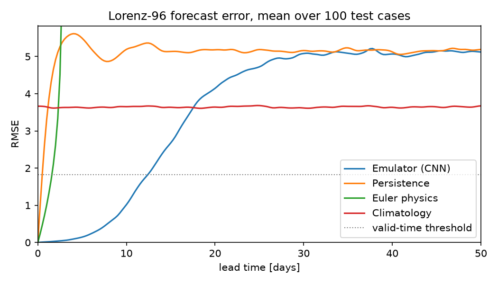
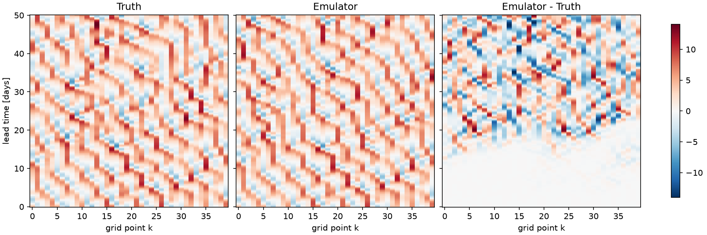

# Lorenz-96 neural emulator

A small convolutional neural network in PyTorch that learns to forecast the
chaotic [Lorenz-96](https://en.wikipedia.org/wiki/Lorenz_96_model) system. It
is a toy version of data-driven weather forecasting. Instead of integrating the
equations, a network learns the one-step map from data and is then run
autoregressively to produce multi-day forecasts.

## The system

Lorenz-96 describes a quantity `x_k` on a ring of `K = 40` grid points,

```
dx_k/dt = (x_{k+1} - x_{k-2}) x_{k-1} - x_k + F,    F = 8,
```

with an advection-like quadratic term, linear damping and constant forcing. It
is chaotic, and one model time unit corresponds to about 5 days in the
atmosphere, so the time step `dt = 0.05` is about 6 hours.

## Approach

- **Data.** 100 independent trajectories of 1000 steps are generated with RK4
  (5 sub-steps per output step) after a spin-up onto the attractor. They are
  split by trajectory into train/validation/test (80/10/10), so that neighbouring,
  nearly identical states never end up on both sides of the split.
- **Model.** A 1D CNN with circular padding predicts the increment
  `x_{t+1} - x_t`. Circular padding matches the periodic domain, and shared
  kernels make the network translation equivariant like the true dynamics
  (this is checked in the tests). Predicting the increment rather than the full
  state makes the learning problem much better conditioned.
- **Training.** Mean-squared error on normalised increments, Adam with a cosine
  learning-rate schedule, best checkpoint chosen on the validation set.
- **Evaluation.** Autoregressive forecasts from 100 test initial conditions,
  compared with
  - *persistence* (the state does not change),
  - *climatology* (the long-term mean state),
  - *Euler physics* (the true equations with one crude forward-Euler step per
    time step, a cheap numerical baseline).

  The *valid time* is the lead time at which the RMSE first exceeds half of the
  climatological standard deviation.

## Quick start

```bash
pip install -e ".[dev]"          # or first: pip install torch --index-url https://download.pytorch.org/whl/cpu
l96-train --out runs/default     # about a few minutes on a laptop CPU
l96-evaluate --run runs/default --out figures
pytest
```

All hyperparameters are command-line options, see `l96-train --help`.

## Results

<!-- Fill in after running l96-evaluate. The numbers are printed and saved to figures/metrics.json. -->

| Forecast       | RMSE at 1 day | Valid time |
|----------------|---------------|------------|
| Emulator (CNN) |               |            |
| Euler physics  |               |            |
| Persistence    |               |            |
| Climatology    |               |            |





## Project structure

```
src/l96emu/
  lorenz96.py   model equations, RK4 integrator, trajectory generation
  data.py       normalisation, train/val/test split, input/target pairs
  model.py      circular CNN and the Emulator wrapper (step, save, load)
  metrics.py    autoregressive rollout, RMSE by lead time, valid time
  train.py      training script (l96-train)
  evaluate.py   evaluation and figures (l96-evaluate)
tests/          unit tests, including physics checks and an end-to-end smoke test
```

## Testing and CI

The tests check, among other things, that the RK4 integrator converges with
fourth order, that the advection term conserves energy, that the network is
translation equivariant and that the full train and evaluate pipeline runs.
GitHub Actions runs linting (ruff) and the test suite on every push.

## Possible extensions

- Train on multi-step rollouts instead of single steps to reduce error growth.
- Learn a larger time step than the one used for the data.
- Compare the CNN with a fully connected network of similar size.
- Add stochasticity or train an ensemble to represent forecast uncertainty.
- Use the two-scale Lorenz-96 system and learn only the unresolved small-scale
  effects (a parametrisation) instead of the full dynamics.

## References

- E. N. Lorenz (1996), *Predictability – a problem partly solved*, ECMWF Seminar on Predictability.
- P. D. Dueben and P. Bauer (2018), *Challenges and design choices for global weather and
  climate models based on machine learning*, Geoscientific Model Development 11, 3999–4009.
- S. Lang et al. (2024), *AIFS – ECMWF's data-driven forecasting system*, arXiv:2406.01465.
